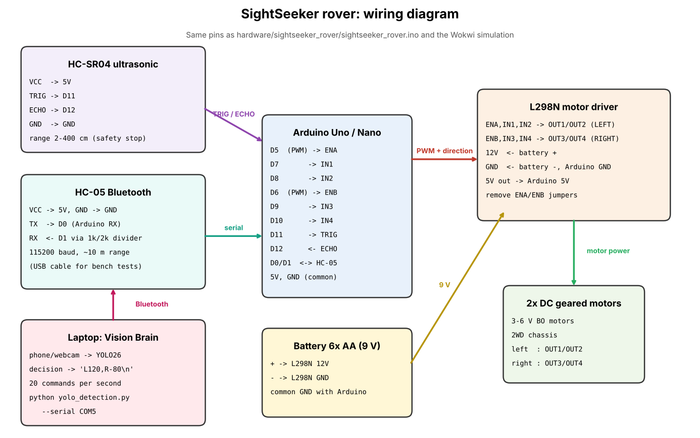
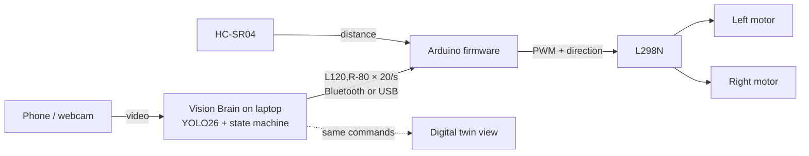

# SightSeeker hardware: rover design, circuit and simulation

SightSeeker's "brain" runs on a laptop (`yolo_detection.py`): it sees with a camera, decides, and sends one
line per wheel command to the rover, 20 times a second:

```
L<left>,R<right>\n        e.g.  L120,R-80     (each wheel -255 … 255, negative = reverse)
```

The rover only has to turn those lines into wheel motion safely. This folder holds its firmware, circuit,
a working simulation (the physical build is planned for the next round), and the plan to build it.

## 1. Components and specifications

| Part | Spec | Job in SightSeeker | Approx. price |
|---|---|---|---|
| Arduino Uno or Nano (ATmega328P) | 5 V, 16 MHz, 6 PWM pins, UART | Runs the firmware: parses commands, drives the motor driver, safety checks | ₹250–450 |
| L298N dual H-bridge motor driver | 5–35 V motor supply, 2 A per channel, PWM speed + direction pins | Powers the two wheels forward/reverse at variable speed | ₹120–180 |
| 2WD chassis with 2 geared DC (BO) motors | 3–6 V, ~200 RPM, 65 mm wheels, caster | Differential drive: wheel speed difference = turning | ₹300–450 |
| HC-SR04 ultrasonic sensor | 2–400 cm, ~15° beam, 5 V | Independent emergency stop: blocks forward motion under 25 cm | ₹60–80 |
| HC-05 Bluetooth module | Bluetooth 2.0 SPP serial, ~10 m indoors | Wireless link from laptop to rover (a USB cable works for bench tests) | ₹200–300 |
| 6× AA battery holder + cells | ~9 V | Motor supply through the L298N; its 5 V regulator powers the Arduino | ₹150–250 |
| Camera: phone (IP Webcam / DroidCam) or USB webcam | 640×480–1280×720 | The robot's eye, mounted facing forward | ₹0 (own phone) |
| Jumper wires, 1 kΩ + 2 kΩ resistors, mini breadboard | | Wiring; the divider drops the Arduino's 5 V TX to 3.3 V for HC-05 RX | ₹100–150 |

**Total: about ₹1,200–1,900.** The laptop that runs YOLO26 is the one used for development.

## 2. Circuit and connections



| From | To | Why |
|---|---|---|
| Arduino D5 (PWM) | L298N ENA | Left wheel speed |
| Arduino D7, D8 | L298N IN1, IN2 | Left wheel direction (IN1 high = forward, IN2 high = reverse) |
| Arduino D6 (PWM) | L298N ENB | Right wheel speed |
| Arduino D9, D10 | L298N IN3, IN4 | Right wheel direction |
| L298N OUT1/OUT2, OUT3/OUT4 | Left / right motor | Motor power |
| Battery + / − | L298N 12V / GND | Motor supply |
| L298N 5V out | Arduino 5V | Logic supply (only with a supply above 7 V and the 5V jumper fitted) |
| Arduino GND | L298N GND | **Common ground (required)** |
| HC-SR04 TRIG / ECHO | Arduino D11 / D12 | Distance ahead, measured ~16× per second |
| HC-05 TX / RX | Arduino D0 / D1 (RX via 1k/2k divider) | Wireless serial link at 115200 baud |

Remove the ENA/ENB jumpers on the L298N so the PWM pins control speed. Unplug the HC-05 from D0/D1 while
uploading firmware over USB (they share the serial port).

## 3. System architecture



**Safety runs on the rover itself, not the laptop:**
1. **Watchdog:** no valid command for 500 ms (link lost, laptop frozen) → motors stop.
2. **Ultrasonic stop:** something closer than 25 cm → forward motion is blocked; turning and reversing still work.
3. **Bounds:** every wheel value is clamped to −255…255; malformed lines are ignored.

## 4. Simulation (Wokwi) and how to run it

The simulation runs the real firmware logic on a simulated Arduino Uno with a simulated HC-SR04 and OLED.

**Run it in the browser (no install):**
1. Go to [wokwi.com](https://wokwi.com) → **New Project** → **Arduino Uno**.
2. Replace `sketch.ino` with [`wokwi/sketch.ino`](wokwi/sketch.ino), and replace `diagram.json` (tab next to it) with [`wokwi/diagram.json`](wokwi/diagram.json).
3. Click the **Library Manager** tab → add **Adafruit SSD1306** and **Adafruit GFX Library** (listed in [`wokwi/libraries.txt`](wokwi/libraries.txt)).
4. Press **▶ Start**.

**What you'll see:**
- After 3 s, **demo mode** replays a real Vision Brain mission at 20 commands/s: scan → turn to the target → forward → avoid an obstacle → goal reached (stop) → forward → **link lost** (the watchdog stops the motors).
- **LEDs = the L298N's inputs:** green = forward pin (IN1/IN3), red = reverse pin (IN2/IN4), yellow = PWM speed (brightness = speed). The left motor is the first group, the right motor the second.
- The **OLED** shows the wheel speeds as bars, the distance, and the safety state.

**Things to test:**
| Test | How | Expected |
|---|---|---|
| Emergency stop | Click the HC-SR04 and drag its distance below 25 cm during a "forward" step | Motors stop, OLED: `BLOCKED: too close` |
| Turning still allowed | Keep the distance under 25 cm during "scan" | Wheels keep turning opposite ways |
| Manual command | Serial Monitor → type `L150,R-150` → Enter | Spins right, then stops 0.5 s later (watchdog) |
| Bad input | Type `hello` | Ignored, nothing moves |

The same logic was also checked automatically on a PC against a mock Arduino: demo sequence, the 25 cm block, watchdog stop, and serial commands taking over from the demo.

**Real firmware:** [`sightseeker_rover/sightseeker_rover.ino`](sightseeker_rover/sightseeker_rover.ino) is the version to upload to the rover. It is the same command parser, watchdog and ultrasonic stop, without the demo mode and OLED.

### 3D rover twin (`rover_3d.html`)

A 3D model of this exact rover (acrylic 2WD chassis, BO motors, L298N, Arduino, HC-SR04, HC-05, 6×AA pack, phone camera) driving in a room. It runs **the same firmware rules** as `sightseeker_rover.ino`: the `L<left>,R<right>` serial protocol at 20 lines/s, the 500 ms watchdog and the 25 cm forward stop from a simulated HC-SR04 (three rays in a ~15° cone), with differential-drive physics (16 cm track, 65 mm wheels, motor lag, PWM dead-band).

Open `rover_3d.html` in Chrome or Edge (it needs `three.min.js` and `OrbitControls.js` beside it; works offline). Keys:
- **1 Find the bottle:** an emulated Vision Brain (same state machine and steering law as `yolo_detection.py`) sees through the phone camera, scans, explores, avoids boxes and stops at the bottle. The inset shows the phone's view with a YOLO-style box. In automated tests it reached the bottle in **30 of 30** random rooms (median ~22 s).
- **2 Wokwi demo:** replays the exact command sequence of the Wokwi sketch, so the LEDs in Wokwi and the 3D wheels show the same thing.
- **3 Drive:** arrow keys send commands like the laptop would. Let go and the watchdog stops the rover 0.5 s later. Drive at a box: the firmware blocks forward motion at 25 cm.
- **E exploded view:** the parts lift apart with labels: what each component is and which pins it uses.
- The panel shows the serial line, the wheel PWM, the six L298N input pins (like the Wokwi LEDs), the ultrasonic distance and the firmware's safety state.

## 5. Simulation limitations

- **No motor physics:** Wokwi has no L298N or DC motor parts, so motors are shown as the logic signals that would drive the L298N (direction LEDs + PWM brightness). Real motors add inertia, stall current and wheel slip.
- **Ideal sensor:** the simulated HC-SR04 returns exact distances; a real one has noise, misses soft or angled surfaces, and has a ~15° cone.
- **No real radio:** the Bluetooth link is not simulated; the demo feeds commands from inside the sketch. Real Bluetooth adds ~20–50 ms latency and can drop out, which is exactly what the 500 ms watchdog handles.
- **Power:** battery sag and the L298N's ~2 V voltage drop aren't modelled (they make the real rover slower at the same PWM).
- The camera detector in the 3D twin is emulated (geometry + line of sight), not YOLO; real YOLO26 runs in the Vision Brain.
- The full see → decide → move loop is shown separately: the Vision Brain's **digital twin** (`D` key) drives a virtual rover with these exact commands, and **walk mode** (`W` key) has a person follow them in a real room.

## 6. Physical implementation plan

| Step | Work | Check |
|---|---|---|
| 1 | Mount the motors, caster, battery holder, L298N and Arduino on the chassis | Nothing rubs the wheels |
| 2 | Wire as in the table above; common ground first | Multimeter: 9 V at L298N, 5 V at Arduino |
| 3 | Upload `sightseeker_rover.ino` over USB; Serial Monitor `L120,R120` with wheels in the air | Both wheels spin forward; swap IN1/IN2 or IN3/IN4 if one spins backwards |
| 4 | Fit the HC-SR04 at the front; hold a hand at 20 cm while sending `L120,R120` | Wheels stop |
| 5 | Add the HC-05 (set to 115200 baud with one AT command), pair it with the laptop | A new COM port appears |
| 6 | Mount the phone facing forward; run `python yolo_detection.py --camera <phone address> --serial COM<n> --twin` | Rover turns toward the bottle and stops in front of it |
| 7 | Tune `--stop-at` and the motor speeds on the real floor; record the demo | |

Estimated build time: one day for assembly and wiring, one day for testing and tuning.
